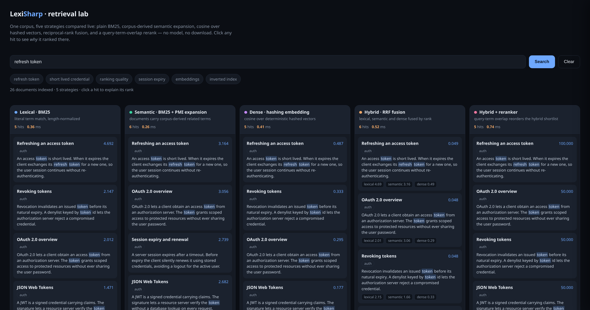

# LexiSharp

[](https://github.com/manuc66/lexisharp/actions/workflows/ci.yml)
[](https://www.nuget.org/packages/LexiSharp/)
[](https://manuc66.github.io/LexiSharp/)
[](LICENSE)

**Search and retrieval for .NET — BM25, rank fusion and reranking in composable pipelines.**

In-memory inverted index, four ranking strategies and their BM25 variants, rank fusion,
reranking, IR metrics and end-to-end search traces. The core references **no NuGet package at
all** (BCL only). PostgreSQL, ASP.NET Core and MessagePack are separate, optional packages, and
your models stay in your application behind a seam you implement.

- **Nothing to host.** No vector database, no embedding API, no native library.
- **Explainable ranking.** Every stage writes a `SearchTrace` (score in/out); `Explain` breaks a
  scorer down to its per-term contributions.
- **Composition, not configuration.** Index, scorer and engine are separate interfaces; hybrid
  retrieval and reranking are decorators over the same `ITextSearchEngine`.
- **Measured, not asserted.** The plain BM25 scorer is checked against published BEIR figures and
  re-checked by a workflow on every relevant push and weekly.

📖 **[Documentation →](https://manuc66.github.io/LexiSharp/)** — guide, reference, and every
measurement with the command that reproduces it.

## Quick start

```bash
dotnet add package LexiSharp
```

```csharp
using LexiSharp.Core;
using LexiSharp.Indexing;
using LexiSharp.Ranking;

ITextSearchEngine engine = new RankedTextSearchEngine(
    new InMemoryTextIndex(), new Bm25Scorer());

engine.Index(new[]
{
    new SearchDocument("1", "The search engine uses BM25 to rank the results"),
    new SearchDocument("2", "TF-IDF is a classic method of textual search"),
    new SearchDocument("3", "Italian cuisine is renowned in Rome"),
});

foreach (var r in engine.Search("textual search"))
    Console.WriteLine($"{r.DocumentId} - {r.Score:0.###}: {r.Document.Text}");
```

Hybrid retrieval and reranking are stages wrapping each other — see
[pipelines](docs/pipelines.md) and [getting started](docs/getting-started.md).

## Does it work?

nDCG@10 on three public BEIR corpora, with analysis, BM25 parameters and metric convention
aligned to the published figures:

| Corpus | LexiSharp | Published |
|---|---:|---:|
| NFCorpus | 0.3218 | 0.3218 |
| SciFact | 0.6789 | 0.6789 |
| ArguAna | 0.4005 | 0.3970 |

Point estimates; the harness also reports paired-bootstrap 95 % CIs. Under the library's own
default analysis and parameters the same scorer reads 0.308 / 0.662 / 0.320 — the difference is
configuration, not ranking. Corpora are md5-verified; numbers are pinned and re-checked by the
`Pinned reference` workflow.

Full tables, CIs, backends and reproducibility:
[evaluation →](docs/evaluation.md).

## See it running

```bash
dotnet run --project samples/LexiSharp.Demo    # → http://localhost:5000
```

Five retrieval strategies over one corpus, compared live — BM25, corpus-derived semantic
expansion, dense hashing embeddings, RRF fusion and a term-overlap rerank — with per-lane
latency, highlighting and a click-through "why did this rank here?" panel. No model, no external
service.



`--corpus nfcorpus|scifact|arguana` runs the same lanes over a BEIR corpus. Details:
[getting started →](docs/getting-started.md#reference-demo-sampleslexisharpdemo).

## Packages

| Package | What it adds |
|---|---|
| `LexiSharp` | Core: index, scorers, fusion, reranking, metrics, traces — no dependencies |
| `LexiSharp.Postgres` | tsvector · pgvector · sparsevec · pg_trgm · pg_search (Tantivy) BM25 |
| `LexiSharp.Onnx` | Local ONNX embeddings and cross-encoder reranking (no model shipped) |
| `LexiSharp.MessagePack` | Binary persistence for the in-memory index |
| `LexiSharp.AspNetCore` | `GET /search` minimal-API endpoint over `LexiSharpIndex<T>` |
| `LexiSharp.Cli` | `dotnet tool`: search a directory, build a store, benchmark a config |

Text analysis (lexical similarity, keyword extraction, Naive Bayes, decision tree, ensemble,
linear classifier): [text analysis →](docs/text-analysis.md).

## Limits (short version)

- **net10.0**, **0.9.0**: the public API may still change between minor versions; pin a version
  and read the [changelog](CHANGELOG.md). 0.9.0 breaks binary compatibility for
  `ITextSearchEngine` implementations, write-capable engine constructors and `SearchResult`.
- ArguAna reads 0.4005 against 0.3970 published (0.0035 short; cause not established). An earlier
  ArguAna figure was withdrawn and is not reproducible by any code path.
- Not every engine/scorer/reranker/merger combination is tested; treat unusual pairings as
  supported but unproven until tested on your data.
- SQL backends are measured on ranking for the engines that rank on their own; sparse and fuzzy
  engines are covered by integration tests only.

Full list with measurements: [scope and limits →](docs/reference.md#scope-and-limits).

## Development

```bash
dotnet build LexiSharp.slnx
dotnet test tests/LexiSharp.Tests
dotnet run --project bench/LexiSharp.Eval -c Release -- --verify-reference   # quality gate
```

The retrieval quality gate replays every pinned configuration on the three BEIR corpora and exits
non-zero on drift (downloads corpora on first run). Benchmarks and the behavioural gate:
[reference →](docs/reference.md#building--testing),
[benchmarks →](docs/benchmarks.md).

## License

MIT — see [LICENSE](LICENSE). The ParadeDB `pg_search` extension used by the BM25 backend is
licensed separately, under AGPL-3.